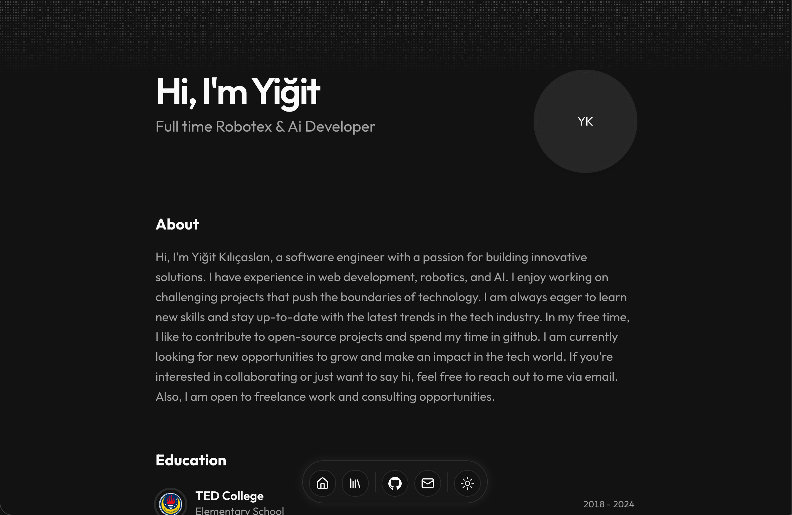

# My Personal Portfolio 🚀

Hi! I'm Yiğit, and this is my personal website. A portfolio is a place to share the things you make and the skills you learn.

I started this website in 2026 when I was 10. I didn't have many projects yet, so building my own website became a project of its own! I started with a copy of Starfolio and made it my own.

Made with code, curiosity, and a lot of love. ❤️

## [Visit my website](https://yigitkilicaslan.com)

[](https://yigitkilicaslan.com)

## What's inside?

- A little about me and what I'm learning.
- Projects I've worked on.
- Robot and coding competitions I've joined.
- Photos from my travels.
- A blog where I share updates on my carrer.

## What is it built with?

- **Astro** for putting the website together.
- **React and TypeScript** help build the parts you can interact with.
- **CSS and Tailwind CSS** control the colors, spacing, and style.
- **MDX** lets me write blog posts with text and custom parts.

## Run it on your computer

You'll need **Node.js version 22.12.0 or newer** and **pnpm** installed. Node.js runs the tools website needs, and pnpm downloads the packages the project needs.

1. Download or clone this project, then open its folder in your code editor.
2. Open a terminal in that folder. A terminal is a place where you type commands for your computer.
3. Download the project's packages:

   ```sh
   pnpm install
   ```

4. Start the website:

   ```sh
   pnpm dev
   ```

5. Open the local address shown in the terminal in your browser. It's usually `http://localhost:4321`.

Save a change to a file and watch the browser update! When you're finished, press **Ctrl + C** in the terminal to stop the website.

## Try changing something

- **Your name, bio, and projects:** `src/data/resume.tsx`
- **Site settings and theme colors:** `src/data/config.ts`
- **Blog posts:** `src/content/blog/`
- **Pictures:** `public/`
- **Website styles:** `src/styles/global.css`

Test it: change a sentence in your bio, save the file, and see what happens.

## Check the finished website

Run `pnpm build` to prepare the website for publishing. Then run `pnpm preview` to view that build on your computer.

## Photo credits

I didn't take the travel photos myself. You can find the photographers, original pictures, and licenses in [Photo credits](credits.md).
